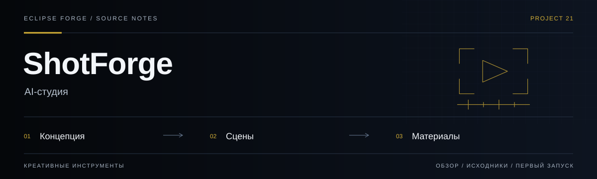
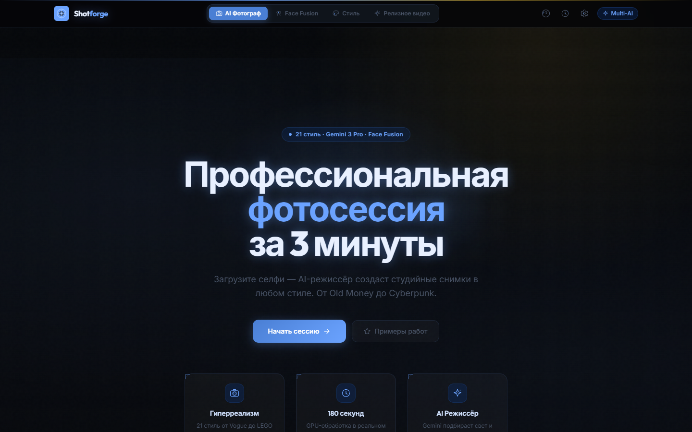
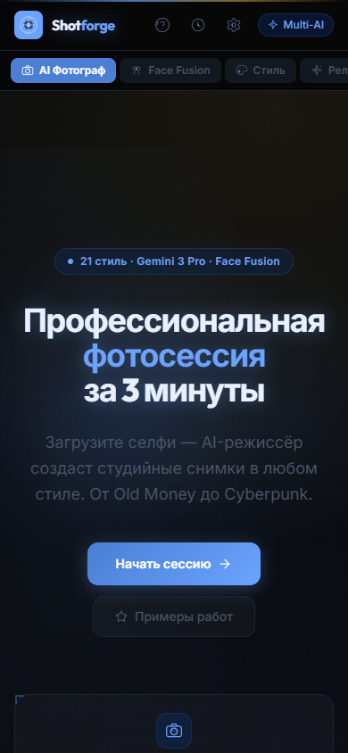

# ShotForge

<!-- project-links:start -->
[Открыть веб-версию](https://shotforge.pages.dev) · [Документация](docs/repository-guide.md) · [Код](https://github.com/PavelHopson/shotforge/tree/main) · [История изменений](https://github.com/PavelHopson/shotforge/commits/main/)
<!-- project-links:end -->



**AI-студия.** Работа с визуальными концепциями, сценами и AI-материалами с передачей результата в медиа-процесс.

<!-- eclipse-forge-projects:start -->
## Проекты Eclipse Forge

[Главная Eclipse Forge](https://eclipse-forge.ru/) · [Eclipse Library](https://library.eclipse-forge.ru/) · [Eclipse DnD Forge](https://dnd.eclipse-forge.ru/)

Исходный код: [Eclipse Forge Landing](https://github.com/PavelHopson/Eclipse-forge-website) · [Eclipse Chat](https://github.com/PavelHopson/eclipse-chat) · [Eclipse Connect](https://github.com/PavelHopson/eclipse-connect) · [Eclipse Library](https://github.com/PavelHopson/eclipse-library) · [Eclipse AI Hub](https://github.com/PavelHopson/eclipse-ai-hub) · [Eclipse Ultron / Sentinel](https://github.com/PavelHopson/eclipse-hopson-sentinel) · [Eclipse Webclaw](https://github.com/PavelHopson/Eclipse-webclaw) · [Eclipse DnD Forge](https://github.com/PavelHopson/eclipse-dnd-forge) · [Finflow](https://github.com/PavelHopson/finflow) · [Eclipse Media](https://github.com/PavelHopson/eclipse-media) · [Shotforge](https://github.com/PavelHopson/shotforge) · [Text2Image](https://github.com/PavelHopson/Text2Image) · [Educator AI](https://github.com/PavelHopson/Educator-AI) · [@pavelhopson/retry-http](https://github.com/PavelHopson/retry-http)
<!-- eclipse-forge-projects:end -->

<!-- repository-guide:start -->
[Интерфейс](#readme-interface) · [Первый запуск](#readme-start) · [Что внутри](#readme-map) · [Путеводитель](docs/repository-guide.md#start) · [Карта кода](docs/repository-guide.md#map) · [Проверки](docs/repository-guide.md#checks) · [Границы и права](docs/repository-guide.md#boundaries)

<a id="readme-interface"></a>

## Интерфейс



**Стартовая страница ShotForge: выбор направления и вход в сценарий AI-фотосессии.**

Локальный снимок от 8 сентября 2026: отдельный профиль браузера, без внешних API и пользовательских секретов. Это вид интерфейса, не подтверждение production-функций.

<details>
<summary><strong>Мобильный экран · 390 px</strong></summary>



</details>

[Открыть в полном размере](docs/assets/ui/overview.png) · [Данные снимка](docs/assets/ui/capture.json)

<a id="readme-map"></a>

## Проект за минуту

- **[Сториборд](<components/ReleaseStoryboardMode.tsx>)** — Интерфейс подготовки последовательности сцен.
- **[Референсы](<services/referenceBoardService.ts>)** — Работа с визуальной доской проекта.
- **[Передача в Media](<services/releaseStoryboardService.ts>)** — Подготовка структурированного плана, не автоматический render.

<a id="readme-start"></a>

## Начать локально

**Среда:** Node.js и npm. **Источник:** [package.json](<package.json>).

Из корня клонированного репозитория:

```bash
npm ci
npm run dev
```

Интерфейс и внешние AI-вызовы — разные этапы. До подключения провайдера проверьте настройки, стоимость и обработку ключей; значения секретов в README не размещаются.

<details>
<summary><strong>Перед первым запуском и изменением кода</strong></summary>

- Команды сверены с исходниками 8 сентября 2026. Это инструкция, а не отметка об успешном запуске или текущем production.
- Установка зависимостей может обращаться в registry и выполнять lifecycle scripts. Используйте отдельную рабочую среду и демонстрационные данные.
- Генерация зависит от провайдера, ключей и стоимости. Передача плана в Media не равна запуску генерации или публикации.
- [ROADMAP.md](<ROADMAP.md>)

</details>
<!-- repository-guide:end -->

## Что это

Shotforge — виртуальная AI-фотостудия с несколькими специализированными режимами:

| Режим | Описание |
|-------|----------|
| **AI Фотограф** | Выбираешь стиль (21 пресет) → настраиваешь параметры → AI генерирует профессиональные снимки |
| **Desktop Creator Kit** | Создаёшь fail-closed JSON-план записи для Eclipse Media: ShareX local-only или FocuSee только для публичного demo, без auto-upload, plugins, servers и history |
| **Face Fusion** | Загружаешь своё фото + одежду/стиль → AI совмещает в одно изображение |

| **Style Transfer** | Загружаешь референс → AI переносит стиль на твоё фото |
| **Релизное видео** | Описываешь релиз → получаешь проверяемую 15-секундную раскадровку JSON для Eclipse Media в форматах 16:9, 9:16 или 1:1 |
## Безопасный handoff в Eclipse Media

Режим «Релизное видео» теперь экспортирует два независимых контракта:

- `eclipse.release-storyboard.v1` — текст и timing пяти сцен;
- `eclipse.creator-capture-plan.v1` — разрешённый desktop capture workflow.

Capture plan создаётся только после подтверждения прав и отсутствия секретов/клиентских данных.
Он не устанавливает и не запускает ShareX, QuickLook, Everything или FocuSee. Cloud upload,
plugins, network servers и history закреплены `false`; публикация требует ручного approval.


---

<a id="product-radar"></a>

## Источники и идеи развития

Источник: [Eclipse Library · July 2026 project integration](https://library.eclipse-forge.ru/#guide/july-2026-project-integration).

| Reference | Как использовать |
|-----------|------------------|
| **Google image/video low-cost tier** | Проверить как дешёвый provider для генерации портретов, product shots, project cards и коротких video previews. Перед внедрением: тест цены, watermark, права использования и качество русского текста |
| **Photo restoration / upscale prompt pack** | Отдельный preset “Restore old photo”: убрать шум/царапины, мягкое sharpening, натуральная колоризация, без пластиковой ретуши |
| **ChatCut / MaxFusion / video-use** | Reference для промо-пайплайна: фотосессия → script → subtitles → voiceover → short-video variants. Не зависимость без API/privacy review |
| **Seed-Audio 1.0** | Reference для озвучки промо-роликов и multi-character demo. Voice cloning только со своим голосом или явным согласием |
| **Torlink** | Не продуктовая фича. Только reference для CLI UX/очередей загрузки в связке с медиа-пайплайнами; публичный downloader не делаем |

---

## Как пользоваться

### Шаг 1: Получить API ключ

Shotforge работает с **Google Gemini AI** (бесплатно). Для получения ключа:

1. Перейди на **[Google AI Studio](https://aistudio.google.com/apikey)**
2. Войди в Google аккаунт
3. Нажми **"Create API Key"**
4. Скопируй ключ (формат: `AIza...`)

> Бесплатный тариф: 15 запросов/минуту, 1500 запросов/день — этого более чем достаточно.

### Шаг 2: Вставить ключ в приложение

Открой Shotforge → нажми **⚙ Настройки** (шестерёнка в хедере) → вставь API ключ → сохрани.

### Шаг 3: Создать фотосессию

#### Режим "AI Фотограф"
1. Нажми **"Начать сессию"**
2. Загрузи своё селфи (или любое фото)
3. AI проанализирует лицо, тон кожи, стиль
4. Выбери пресет:

| Пресет | Стиль |
|--------|-------|
| Old Money | Тихая роскошь, лён, яхт-клуб |
| Vogue Editorial | Высокая мода, контраст, студия |
| Cyberpunk Tokyo | Неон, дождь, мокрый асфальт |
| LinkedIn Pro | Чистый фон, деловой стиль |
| Film Noir | Ч/б, драматические тени |
| Cinematic Adventure | Пейзажи, golden hour |
| Manga / Anime | Японский стиль, яркие глаза |
| Pixel Art Retro | 16-bit, ретро-игры |
| Product Photo | Белый фон, студийный свет |
| 3D Isometric | Миниатюра, tilt-shift |
| Ukiyo-e 浮世絵 | Японская гравюра, Хокусай |
| LEGO Miniature | Фигурка LEGO, макро |
| Comic Book | Комикс, жирные контуры |
| Watercolor | Акварель, мягкие края |
| Hyper-Real Selfie | Видимые поры, без ретуши |
| Macro Skin | Макро-съёмка кожи |
| Interstellar | IMAX 70mm, космические пейзажи |
| Blade Runner Noir | Неон-нуар, teal-orange |
| Studio Ghibli | Miyazaki, пастельные тона |
| Pixar / Disney 3D | Стилизованный 3D, яркие цвета |
| Indie Film Memory | Ностальгия, плёночное зерно |

5. Настрой параметры:
   - **Пол/возраст** — кого изображаем
   - **Эмоция** — серьёзный, улыбка, уверенный, задумчивый
   - **Освещение** — студийное, golden hour, неон, кинематографическое
   - **Камера** — 85mm портрет, 35mm editorial, макро, full body
   - **Одежда** — свободный текст (Business Casual, Evening Gown...)

6. Нажми **"Сгенерировать"** → получи 4 варианта фотографий

#### Режим "Face Fusion"
1. Загрузи своё лицо
2. Загрузи одежду, обувь, аксессуары (отдельные фото)
3. Выбери стиль/фон
4. AI совместит всё в одно фото

#### Режим "Style Transfer"
1. Загрузи своё фото
2. Загрузи референс стиля
3. AI перенесёт стиль на твоё изображение

---

## Настройка AI-провайдера

В **⚙ Настройки** можно выбрать провайдера:

| Провайдер | Как получить ключ | Стоимость |
|-----------|-------------------|-----------|
| **Google Gemini** | [aistudio.google.com/apikey](https://aistudio.google.com/apikey) | Бесплатно (15 req/min) |
| **OpenAI** | [platform.openai.com/api-keys](https://platform.openai.com/api-keys) | От $5 кредитов |
| **OpenRouter** | [openrouter.ai/keys](https://openrouter.ai/keys) | Много бесплатных моделей |
| **Ollama (локально)** | [ollama.com](https://ollama.com) → `ollama pull llama3.2-vision` | Бесплатно, на вашем GPU |

### Для генерации изображений

Gemini 2.5 Flash умеет генерировать изображения напрямую. Для лучшего качества:

| Модель | Возможности |
|--------|------------|
| `gemini-2.5-flash` | Промпты + текст (быстрый) |
| `gemini-2.5-pro` | Промпты + текст (качественный) |
| `gemini-3-pro-image-preview` | **Генерация изображений** (рекомендуется) |

---

## Стек

| Технология | Роль |
|-----------|------|
| React 19 + TypeScript | UI компоненты |
| Vite 6 | Сборка |
| Tailwind CSS 3.4.19 | Статический проверяемый CSS; runtime CDN отсутствует |
| Google Gemini AI | Креативный директор + генерация |
| Lucide React | Иконки |

---

## Быстрый старт

```bash
git clone https://github.com/PavelHopson/shotforge.git
cd shotforge
npm install

npm run dev
# → http://localhost:3000
```


API-ключ задаётся только в интерфейсе через **Настройки** и сохраняется в localStorage
текущего браузера. Build-time .env для ключа не используется: секрет не должен попадать
в JavaScript bundle. На общем устройстве удалите ключ из настроек после работы.

### Сборка и деплой

```bash
# Проверяет SHA-256 source/output manifest для committed CSS
npm run css:verify
npm run build
# → dist/

# Cloudflare Pages
npx wrangler pages deploy dist --project-name=shotforge
```

Tailwind не исполняется в браузере и не загружается с CDN. `styles.generated.css` собирается
только локально точной версией `tailwindcss@3.4.19`; отсутствие локального package или другая
версия fail closed, а не запускает сетевую установку. `styles.generated.integrity.json` связывает SHA-256
исходников и результата. После изменения class names или `styles.css` выполните
`npm run css:build`, проверьте CSS diff и только затем запускайте production build.
Если exact package ещё не добавлен в devDependencies, дождитесь доступного npm registry и
добавьте его вместе с lockfile отдельным reviewed dependency change. Текущий production build
использует committed CSS и не требует Tailwind CLI. Для уже проверенного package вне repository
можно явно передать абсолютный путь к его `package.json` через `SHOTFORGE_TAILWIND_PACKAGE`;
скрипт всё равно проверит exact version до исполнения.

---

## Структура

```
shotforge/
├── App.tsx                  # Главный компонент (3 режима)
├── index.tsx                # Точка входа
├── styles.css               # Tailwind input + собственные стили
├── styles.generated.css     # Проверенный статический production CSS
├── tailwind.config.cjs      # Зафиксированные design tokens/content paths
├── types.ts                 # TypeScript типы
├── constants.ts             # 21 пресет стилей
├── components/
│   ├── Header.tsx           # Навигация с табами режимов
│   ├── Hero.tsx             # Главный экран
│   ├── ConfigPanel.tsx      # Панель настроек съёмки
│   ├── UploadSection.tsx    # Загрузка фото
│   ├── FaceFusionMode.tsx   # Face Fusion режим
│   ├── ResultsGallery.tsx   # Галерея результатов
│   ├── SettingsPanel.tsx    # Настройки AI-провайдера
│   └── Button.tsx           # UI-кнопка
├── services/
│   └── geminiService.ts     # AI-сервис (Gemini + Ollama + multi-provider)
└── vite.config.ts
```

---

## Лицензия

[MIT](LICENSE)

---

<div align="center">
<sub>Сделано с ⚡ в Eclipse Forge</sub>
</div>
<a id="eclipse-forge-visual-contract"></a>

## Визуальный стандарт Eclipse Forge

Shotforge uses the local `eclipse-forge.visual-system.v1` snapshot in the `product` profile: self-hosted Outfit/Inter typography, signal-blue actions, warm-gold accents, grid/grain depth and reduced-motion-safe reveals. The contract is local and does not create a runtime dependency on the Landing.

Visual pilot verified on 2026-08-12 with generated Tailwind integrity, TypeScript and production build.
